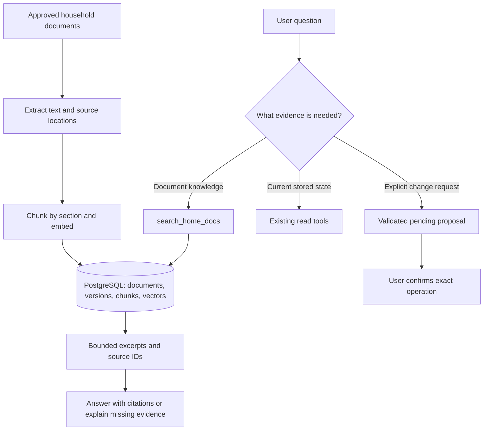

# Home AI Agent System — Version 3: Phase 3 completion record

**Updated: 5 October 2026 · Phase 2 complete · Phase 3 complete for the defined local scope**

This is the Phase 3 implementation plan and completion record. It turns the short RAG outline in the earlier plans into the completed implementation sequence, records what Phase 2 taught us, and documents the checks completed before document retrieval joined the assistant. Implementation evidence is in [Phase 3 findings](../../results/phase-3/findings.md). The next execution plan is [Version 4 — Phase 4 Memory](home-ai-agent-project-plan%20v4.md).

**How to use this plan:** Sections 1–8 explain the scope, evidence, lessons, and acceptance criteria. Section 9 is the concrete implementation blueprint, including storage, API contracts, correction tasks, file ownership, build order, and verification. Use `http://127.0.0.1:9000` for this project's running API and `/docs` for Swagger. Updating this plan does not start implementation or change the running service.

Phase 3 taught the assistant to answer household questions from identifiable documents, show the supporting source, and admit when the documents do not contain the answer. The existing Python/FastAPI, local Ollama `qwen3:8b`, and PostgreSQL stack now includes document ingestion, embeddings, pgvector retrieval, citations, durable indexing, and an evaluation set.

## 1. Progress and evidence

| Phase | Status | Date / next outcome |
|---|---|---|
| 0 — Foundations | Complete | 24 September 2026 |
| 1 — Prompting and structured output | Complete, with tracked follow-ups | 4 October 2026 |
| 2 — Function calling and tools | **Complete as an implementation milestone** | 4 October 2026; evidence reviewed 5 October |
| 3 — RAG over home knowledge | **Complete for defined local scope** | 5 October 2026; evidence in Phase 3 findings |
| 4 — Memory | Not started | Session state and explicit persistent preferences |
| 5 — Agent loop | Basic bounded loop already exists; remaining phase not started | Multi-step evaluations and framework comparison |
| 6 — Multi-agent orchestration | Not started | Small specialist-routing experiment |
| 7 — MCP | Not started | Expose the established tools through MCP |
| 8 — Guardrails, evaluation, observability | Baseline exists; full phase not started | Broader adversarial tests, traces, authorization |
| 9 — AWS deployment | Not started | Deploy after access controls are implemented |
| 10 — Interview demonstration | Not started | Reproducible demo and documented trade-offs |

Evidence: [Phase 2 findings](../../results/phase-2/findings.md), [case definitions](../../results/phase-2/held-out-eval.json), [guard-on responses](../../results/phase-2/guard-on-results.json), and [guard-off responses](../../results/phase-2/guard-off-results.json). Earlier plans remain available as [original roadmap](home-ai-agent-project-plan.md) and [v2 Phase 2 record](home-ai-agent-project-plan%20v2.md).

The v2 file already marked Phase 2 done but had a Version 3 heading and an “in progress” timeline. Those inconsistencies are corrected. The completion date is preserved; the evidence corrections are dated separately.

## 2. What Phase 2 actually established

We built five household tools plus five generic CRUD tools covering seven household entities. Reads run immediately; writes become pending proposals and require an explicit action-ID confirmation through the API. Validation, date resolution, database constraints, and execution are controlled by Python. The model chooses and proposes tools; it does not own permission to execute a write.

The supplied tests cover schema validation, several date rules, response filtering, bounded extraction retry, and database confirmation/CRUD behavior. The original record says 15 checks passed. During this review, **13 database-independent tests passed**; the two database tests and live Ollama evaluations were not rerun. Existing test success does not cover every issue below.

| Finding from the saved evidence | Correct interpretation | Consequence for Phase 3 |
|---|---|---|
| H01–H09 final responses are consistent with their expected behavior | Nine response-level successes per run; saved summaries do not prove every tool/field/state assertion | Capture tool traces and expected fields alongside prose |
| H10 refuses both the malicious quote and the legitimate door-state question | Injection refused, task failed in both runs; the earlier 10/10 claim was incorrect | Score useful completion separately from refusing attacks |
| H08 ends in a clarification after a reported earlier false success claim | Application safeguards helped; the earlier raw failure is not in the saved JSON | Keep raw and filtered responses for diagnosis |
| Three intended writes produce pending summaries in each run | Consistent with staging; unchanged DB state needs snapshots or integration assertions | Check writes independently of assistant wording |
| Guard-off still uses the prompt, tool validation, confirmation, and final filter | A pre-model-guard comparison, not a raw-model safety benchmark | Name evaluation modes precisely |
| Mean latency is 1.3759 s on / 1.5160 s off across the saved ten cases | Small local sample including a 0 ms pre-model refusal; no paired thinking-on control | Measure comparable workloads and separate stage timings |
| H08 informed a safeguard | The old held-out set has now influenced development | Keep it for regression; freeze a fresh set before tuning again |

### Lessons to be able to explain

1. **Valid structure does not mean correct meaning.** JSON may parse while the date, participant, quantity, or target is wrong. RAG citations can similarly be well formed yet fail to support the answer.
2. **Permission belongs in application code.** Prompt rules influence behavior; confirmation and validation determine whether state changes. Retrieved text must never gain execution authority.
3. **Safety and usefulness are separate measurements.** H10 avoided the injected claim but failed the user's valid question. A system that refuses everything is not a successful assistant.
4. **Observe each layer.** A final answer hides retrieval mistakes, bad tool arguments, and application corrections. Record enough intermediate evidence to locate the failure.
5. **An evaluation becomes a regression set once used for tuning.** Report development results and untouched hold-out results separately.
6. **Confirmation must refer to a stable operation.** Store the exact resolved action the user reviews. Reinterpreting “tomorrow” or matching a device again later can change the action.

## 3. Step 3.0 — Completed reliability work before integrating RAG

Allow 1–2 focused days initially, extending this if the tests expose more work. Corpus selection and extraction experiments can start in parallel with these fixes, but do not enable document-driven chat until the checks below pass. These are recommended engineering gates, not completed repairs.

| ID | Work and reason | Completion evidence |
|---|---|---|
| P3-01 | Fix H10 handling: ignore the quoted instruction while answering the legitimate device read. Avoid solving this by blanket refusal. | H10 and several unseen paraphrases return tool-backed state or a real not-found/clarification result, without accepting the quote |
| P3-02 | Render write status from application outcomes. The current claim filter skips its false-success check whenever any pending action exists. | Mock “Done, added milk” with a pending proposal; output says pending, not executed. Cover mixed successes/errors and unrelated pending actions |
| P3-03 | Freeze resolved calendar timestamps and stable target IDs at proposal creation, show them for review, and reject stale/conflicting targets at confirmation. | A proposal spanning midnight preserves its date; changed/deleted targets cannot silently redirect it; ambiguous/nonexistent DST times have a tested clarification policy |
| P3-04 | Strengthen the evaluation runner: separate task/safety/field assertions, capture normalized arguments and raw/final responses, use fixed fixtures/reference dates, and clean up in `finally`. | A deliberately failing run still accounts for/rejects its proposals; exported evidence verifies no household write before confirmation; HTTP tests cover route behavior |
| P3-05 | Extend shared action tests for expiry, concurrent confirmation, rollback, and repeated equivalent proposals. Same-ID replay is already covered; different UUIDs are not deduplicated. | Concurrent confirmation executes once; expired/rejected actions do not execute; failed transactions do not partly write; repeated proposals have a deliberate deduplication policy |

P3-01 through P3-04 gate chat integration. P3-05 gates reuse of the action lifecycle for document mutations. Keep tool execution real only in an isolated test database; use mocked tools for raw-model diagnostic experiments.

**Later work with explicit boundaries:** typed device-state validation can follow while devices remain simulated, but must precede real-device control. Authentication, per-user authorization, and action ownership must precede shared/network access. A paired thinking-on/off benchmark and broader model comparisons are useful experiments, not prerequisites for local corpus preparation.

## 4. What Phase 3 delivered

Example question: “According to our dishwasher manual, how should I clean the filter?” The assistant searches the correct appliance manual, uses the relevant passage, and cites its document version and page. If we have only a different appliance's manual, it asks for the correct model instead of borrowing instructions.

Another question: “Is the hall light on?” still calls `get_device_state`. A document can explain a device or household rule; it cannot establish its live state. “Add the recommended filter-cleaning reminder” remains a separate user-requested write, staged for confirmation.



The diagram describes application responsibilities. Retrieved passages remain data, regardless of wording that claims to be a system instruction or tells the assistant to call a tool.

## 5. Implementation sequence

### Step 3.1 — Choose a small corpus and define the questions

Start with approximately 5–10 documents: one or two actual appliance manuals, house rules, a maintenance checklist, and non-sensitive household preferences. Record which appliance model each manual applies to, the document owner, version/effective date, and whether it is current. Mark synthetic fixtures clearly so invented examples never become household facts.

Create a corpus manifest with source filename, content hash, document ID, title, category, appliance model, revision, and extraction status. Pick development questions whose answers can be traced to exact sections before writing retrieval code. Include missing answers, similar appliance names, conflicting rules, and a malicious note fixture.

**Learning:** corpus quality and source selection come before vector search. A perfectly retrieved wrong manual still produces a wrong answer.

**Done when:** each development question has an expected source and answer facts, or an explicit reason to abstain/clarify.

### Step 3.2 — Extract text while preserving provenance

Support Markdown/plain text first, then text-based PDFs. Preserve headings and PDF page numbers (record printed page labels separately if they differ). Inspect extracted lists, tables, warnings, numbers, and units against the source. Flag scans with no usable text as unsupported until OCR is deliberately added; do not index an empty extraction as successful.

Reject unsupported formats, oversized inputs, and invalid source paths with a clear error. Keep ingestion local and limited to selected files. Credentials and secret-bearing configuration files are outside the corpus.

**Learning:** retrieval cannot recover text that extraction lost. Page references must survive preprocessing if citations are to be auditable.

**Done when:** a small inspection report shows original sections alongside extracted text and source locations, including an extraction failure case.

### Step 3.3 — Add document storage and lifecycle management

Proposed tables: `home_documents` for user-managed metadata and active version; `home_document_versions` for source hash, revision, extraction/chunking/embedding configuration and status; `home_document_chunks` for text, section/page span, chunk ordinal, and embedding. Use stable IDs and record the actual vector dimension. Chunks and ingestion bookkeeping are derived/internal data, not independently editable household records.

Add an existing-database migration such as `003_home_documents.sql`, along with fresh-database setup. The Compose image already uses pgvector, but migration checks must verify/enable the extension in the actual database rather than assume the image alone enabled it.

Plan complete document lifecycle support, consistent with the project's existing CRUD convention:

| Operation | Proposed API/tool behavior |
|---|---|
| List/read documents and indexing status | Immediate read-only API and assistant tools |
| Add a document | Validate selected content and show metadata/hash in a pending proposal; confirmation authorizes indexing |
| Update metadata or replace a source | Stage and confirm a new version; source changes rebuild affected chunks |
| Delete a document | Stage and confirm removal from retrieval; keep the audit record |
| Reindex after configuration changes | Explicit controlled maintenance operation; show the affected document/version |

Expose these through documented `/documents` routes and dedicated assistant tools; do not expose arbitrary filesystem access or let the model edit embeddings. Reuse confirmation without simply adding every internal table to generic CRUD.

Build a replacement version separately and activate it atomically only when all chunks are ready. A failed replacement leaves the old active version available and reports the failed attempt. Re-ingesting identical content/configuration should not duplicate vectors. Deleted or superseded versions must not appear in current retrieval.

**Learning:** RAG needs update/delete semantics and reproducibility, not just a one-time embedding script.

### Step 3.4 — Chunk and embed with a measured baseline

Keep headings with their paragraphs and keep instructions, warnings, and table rows together where possible. Start around 400 tokens per chunk with roughly 60 tokens of overlap, treating these as experiment settings. If a word/character approximation is used, label it honestly and still enforce the embedding model's actual input limits. Compare roughly 250- and 700-token alternatives on the development questions.

Use a dedicated local embedding model; keep `qwen3:8b` as the answer-generating model. Start by smoke-testing `embeddinggemma`, record its exact installed identifier/digest and output dimension, and use the same embedding model/configuration for documents and queries. Ollama documents `embed`/`/api/embed` and this same-model requirement in its [embedding guide](https://docs.ollama.com/capabilities/embeddings).

Pin the selected configuration in ingestion metadata. Validate nonempty finite vectors and expected dimension. A change of embedding model requires a compatible rebuild; vectors from incompatible models must not be silently mixed. Batch work, bound retries, and expose failed indexing status instead of partially activating a document.

**Learning:** embeddings represent similarity; they do not verify facts. Smaller chunks improve focus but may lose context, while larger chunks preserve context at a cost in irrelevant text and prompt size.

### Step 3.5 — Implement and inspect retrieval independently

Add read-only `search_home_docs(query, limit, document_id?, appliance_model?)`, with a nonempty bounded query, validated filters, and a small bounded result count. Start with `top_k=4` and exact cosine-distance search for this small corpus. pgvector provides exact search by default and cosine-distance operators; approximate indexes can be evaluated later if corpus size justifies them. See the [pgvector documentation](https://github.com/pgvector/pgvector).

Return `document_id`, version ID, chunk ID, title, page/section, excerpt, and distance. Apply active-version and metadata filters before selecting results. Do not present similarity as a calibrated confidence percentage. Always selecting a nearest chunk does not mean that chunk answers the question.

Inspect top results before generating answers. Tune relevance/abstention handling only on development data. If exact error codes, model numbers, or quantities are missed, compare a simple keyword/metadata baseline and, if necessary, hybrid retrieval. Do not silently substitute another appliance model because its text is similar.

**Learning:** distinguish a retrieval failure (right evidence absent from results) from an answer failure (right evidence present but misused).

### Step 3.6 — Integrate grounded answers into the existing loop

Register the search tool in the current registry and extend the existing five-iteration loop; do not build a second orchestrator. Add limits on total calls, retrieved characters/tokens, and duplicate searches so several calls inside one iteration cannot create unbounded context.

For document-specific questions, require retrieved evidence before giving household-specific facts. Pass excerpts in a clearly delimited data structure with server-issued citation IDs. Treat instructions inside those excerpts as untrusted content. A request to summarize a document must not turn that document's action instructions into pending writes.

Have the model return answer text plus cited IDs. Check in code that every ID was returned for that request and resolve citations from stored metadata. This validates provenance, not semantic support: evaluation must separately check that the cited passage supports the statement. On malformed citations, unsupported claims, missing evidence, or conflicting sources, use a bounded correction attempt or an explicit abstention/clarification.

Preserve numbers, units, conditions, and warnings from the matching source. Explain conflicts and versions; only prefer a source automatically when an explicit applicability/current-version rule resolves the conflict. Reuse the existing structured preferences table as the source of current stored preferences when appropriate, avoiding two competing sources of truth.

**Learning:** RAG changes the information supplied to the model at request time; it does not train new weights or guarantee a correct answer. Source validity, retrieval relevance, and answer faithfulness are separate checks.

### Step 3.7 — Evaluate, record failures, and demonstrate

Build a development set of about 20 questions, then freeze a separate held-out set of 20 before final tuning. Suggested held-out composition: 8 direct/paraphrased answerable questions, 4 exact-number/model/code questions, 3 missing-answer questions, 2 conflicting/stale-source cases, and 3 embedded-injection cases with legitimate questions. Keep Phase 2 regressions as a separate suite rather than adding their successes to the RAG denominator.

Each case records expected source document/version/section, required facts, acceptable abstention or clarification, expected tool family, and prohibited actions. Run against a fixed corpus snapshot and record model/configuration versions. Compare the same questions with retrieval disabled as a knowledge baseline; separate cold-start and warmed timings.

| Measurement | How we will judge it |
|---|---|
| Retrieval hit rate at k | Among questions with known supporting evidence, fraction with at least one relevant chunk in top k |
| Multi-passage coverage | Where several passages are required, fraction of required evidence units retrieved |
| Answer correctness | Required facts, conditions, numbers, and units match the source |
| Groundedness | Each material source-dependent claim has support; no added household facts |
| Citation validity and support | IDs exist in this request's results; cited passages actually support their associated claims |
| Missing/conflicting evidence | Correct abstention or clarification, without silently selecting the wrong source |
| Injection resistance and task completion | Malicious instructions ignored while the legitimate question is still completed where possible |
| Write boundary | Read-only document questions produce no write proposal and no household mutation; explicit writes remain confirmation-gated |
| Performance | Separate extraction, embedding, search, generation, total time, context size, cold/warm runs; report median/p95 with sample size |

Proposed local learning targets: at least 90% retrieval hit rate and 90% correct grounded answers on the answerable held-out subset; 100% structurally valid citations; no unsupported safety-critical numbers/instructions; all missing/conflict cases handled as specified; and no injection-induced write proposals or mutations in the test set. These are acceptance targets, not achieved results or statistical guarantees. Record numerator/denominator and every failure, even when the aggregate target passes. Do not tune on the held-out set and continue calling it untouched.

## 6. Deliverables and completion checklist

Proposed implementation locations: `src/app/documents.py` for source lifecycle/extraction, `src/app/retrieval.py` for embeddings/search, existing `tools.py`/`llm.py`/`schemas.py` for integration, a Phase 3 migration, and focused unit/integration tests. These filenames are a design proposal and do not exist yet.

- [x] Step 3.0 fixes have their specified regression evidence.
- [x] Corpus manifest and source applicability/version metadata are recorded.
- [x] Document create/read/list/update/delete works through documented routes and appropriate tools, with confirmation for mutations.
- [x] Existing-database migration works without replacing the household database.
- [x] Duplicate ingestion, failed replacement, reindex, deletion, and stale-version exclusion are tested.
- [x] Retrieval returns bounded excerpts with stable, resolvable source references.
- [x] Chat cites evidence, handles missing/conflicting sources, and distinguishes document facts from live state.
- [x] Embedded instructions do not create proposals or change permissions.
- [x] Phase 2 tests still pass; DB-dependent execution is included in the 42-test isolated-database run.
- [x] `results/phase-3/` contains development and held-out definitions, raw results, corpus/config manifest, metrics, and `findings.md` with failures and limitations.
- [x] README includes new routes, ingestion/update/delete examples, error behavior, and a reproducible demo.

Suggested demo: ingest and confirm a document; ask a paraphrased question and inspect its citation; ask an unanswerable question; retrieve a malicious-note fixture while still answering its legitimate question; update/delete a document and prove stale content disappears; request a reminder and demonstrate the existing confirmation boundary.

## 7. Effort and scope

Allow roughly **7–10 focused working days**, including the preparatory fixes: 1–2 for Step 3.0; 1 for corpus/extraction; 2 for lifecycle/storage/embedding; 1 for retrieval; 1 for chat/citations; and 1–3 for evaluation and failure-driven fixes. This replaces the earlier optimistic one-week sketch. Actual time depends on PDF quality and the reliability fixes.

Defer OCR, rerankers, large-scale approximate indexes, autonomous ingestion, new agent frameworks, multi-agent delegation, and cloud deployment until a measured limitation justifies them. Phase 4 will add conversation and long-term memory; Phase 5 will extend and evaluate the bounded loop already built in Phase 2, then compare a framework implementation.

## 8. What we should learn by the end

| Concept | Concrete explanation this project should support |
|---|---|
| Embeddings versus generation | One model maps text to searchable vectors; another constructs the answer from retrieved evidence |
| RAG versus fine-tuning | Retrieval supplies updatable external facts with provenance; fine-tuning changes model behavior/weights and is not a substitute for fresh sources |
| RAG versus long context | Small corpora may fit directly in context; compare simplicity against repeated context cost and retrieval's risk of missing evidence |
| Chunking and ranking | Show a question that failed under one configuration, explain the missing context or distracting text, and measure the improvement |
| Grounded answers | A real citation is necessary but insufficient; its passage must support the claim and apply to the right appliance/version |
| Trust boundaries | Document authors can supply information, but cannot authorize tools or override application permissions |
| Evaluation quality | Separate retrieval, answer quality, citation support, safety, usefulness, and latency; keep a genuinely fresh final set |
| Operational behavior | Demonstrate version replacement, deletion, failure recovery, and the reproducibility of a result from its manifest |

Phase 2 and Phase 3 are complete with their limitations visible. The next planned work is Phase 4 memory. Keep the Phase 3 evaluation artifacts as regression evidence and use new untouched cases for future retrieval tuning.

## 9. Concrete implementation blueprint

### 9.1 Agreed behavior and implementation boundaries

Upload once, confirm addition, wait for indexing, then ask questions repeatedly without re-uploading. Original files persist on local disk; extracted passages, metadata, embeddings, and job state persist in PostgreSQL. Restarting FastAPI or Ollama must not lose the knowledge base. This is retrieval from saved documents, not model training.

The first interface is Swagger at `http://127.0.0.1:9000/docs`, with normal REST access. A separate React upload screen is outside this phase. Support UTF-8 `.txt`/`.md` and text-based `.pdf`; OCR and password-protected PDF handling beyond a clear rejection are deferred. Begin with 5–10 selected files and the existing local single-household environment.

Use provisional configurable limits: 10 MiB per upload, 200 PDF pages, 1 million extracted characters, a 2,000-character search query, and 1–8 returned chunks (default 4). Limit extraction time and total retrieved context separately. Treat these as resource controls to measure and adjust, not universal library limits.

### 9.2 Correction work packages — implement before extending the action system

| Package | Concrete implementation | Existing modules affected | Required tests |
|---|---|---|---|
| P3-01: preserve the benign question | Separate quoted/retrieved data from the user's requested operation in prompt construction; keep live-state questions grounded in read tools. Add a bounded recovery path when an answer refuses a valid read alongside an injection. Do not hard-code H10 text or trust instructions extracted from the quote. | `prompts.py`, `llm.py`, `main.py` | H10 and paraphrases; absent/ambiguous device; attack-only request; valid read with malicious quote. Assert usefulness and safety separately. |
| P3-02: truthful action status | Introduce typed tool outcomes and an application-generated action summary. Do not let a boolean such as “some proposal exists” determine whether success claims are acceptable. Assemble pending/rejected/expired/failed/completed wording from each action's persisted state; do not reuse unconstrained model prose as the action-status authority. | `schemas.py`, `llm.py`, `tools.py`, `main.py` | Pending plus “Done”; one pending action alongside another failed action; no write at all; actual confirmed result; loop exhausted with proposals still pending. |
| P3-03: stable proposals | Add a preparation layer that returns normalized execution arguments plus a display summary. Resolve date/time and target IDs once, store them with a payload schema version and target revision/preconditions, and execute that payload. Recheck existence/constraints without rematching names or recalculating relative dates. | `tools.py`, `crud.py`, `database.py`, `schemas.py` | Midnight rollover; DST gap/overlap; renamed/deleted/replaced targets; participant identity changes; stale updates; displayed details equal executed details. |
| P3-04: auditable evaluations | Allocate a run/request ID before tool execution; record every proposed action ID at persistence time, raw/final answers, typed tool outcomes, expected fields, configuration, and timings. Cleanup queries by run ID in `finally`, including actions created before an exception. | `evaluate_phase2.py`, `database.py`, `llm.py`, tests | Forced mid-run failure; cleanup failure reported; no household mutation from proposal-only requests; route-level tests; exact quantity, unit, title, participants, timestamp, and device ID. |
| P3-05: robust action lifecycle | Retain row locking and transactionality; represent expiry distinctly from execution failure. Deduplicate equivalent calls within one request using normalized operation/arguments. Support an optional client idempotency key for request retries, without suppressing a later intentional duplicate request. | `tools.py`, `database.py`, `main.py`, migrations | Two concurrent confirms; repeat reject/confirm; expired proposal; partial-write rollback; duplicate model calls; same client key retry; distinct intentional requests. |

Use an additive `003_action_reliability.sql` migration for action payload/version, run IDs, preconditions, idempotency constraints, and any revised status constraint. Reserve `004_home_documents.sql` for the document schema; these concrete names replace the earlier illustrative `003_home_documents.sql` filename. At migration time, invalidate still-pending legacy payloads that lack stable execution details and require a fresh proposal. Preserve completed/rejected history. Document the mapping of legacy `failed` rows instead of silently declaring them all execution failures or all expired.

Do not hold a database lock while calling Ollama. For ordinary household writes, mutation, final action state, and audit outcome belong to one transaction. On an error, roll back changes before persisting an accurate failure outcome in a separate short transaction where needed.

### 9.3 Persistent source storage and upload workflow

Use a configurable `DOCUMENT_STORAGE_DIR`, defaulting to `storage/documents/` under the project. Suggested subdirectories are `staging/` and `sources/<document_id>/<version_id>/`. Generate storage names on the server; retain the user's filename as metadata only. Never accept arbitrary filesystem paths from assistant tools. Add the storage directory to `.gitignore` during implementation.

1. `POST /documents/uploads` streams a selected file into staging, validates format/size, computes SHA-256, and returns an opaque upload ID with metadata and a proposed expiry (default 24 hours).
2. Uploading authorizes temporary storage only. The file is not searchable, does not create a household document, and is not embedded yet. A bounded parser check may inspect it for validity.
3. `POST /documents` takes the upload ID and document metadata, then stages a pending action with the exact content hash and display details. The upload ID must still be valid when confirmation occurs.
4. Confirmation uses the existing `/actions/{id}/decision` route. It transactionally creates the document/version record and one durable ingestion job, then returns the job ID. “Confirmed” means indexing was authorized, not that indexing has finished.
5. The worker verifies the source hash, stores the source in its final version directory, extracts/chunks/embeds it, then activates the completed version. The document becomes searchable only after activation.
6. Rejected/expired unused uploads are removed by a bounded cleanup routine. Source bytes referenced by an active or queued job are protected from staging cleanup.

Filesystem operations and database commits are not one transaction. Make copy/move steps idempotent using stable IDs and hashes, and reconcile missing/orphaned files on retry. Do not remove staging bytes before the durable version has a valid source. Store relative storage keys, not user-supplied absolute paths.

Back up the document directory and database together; restoring one without the other is incomplete. A restart test must prove source download and question-answering still work. Normal restarts do not recreate embeddings.

### 9.4 Database contracts

| Record | Minimum fields and constraints |
|---|---|
| `home_documents` | UUID `id`, title, category, appliance model, applicability/effective date, active version ID, revision, creation/update times, deletion state. Active version must belong to this document. |
| `home_document_versions` | UUID `id`, document ID, source hash, original filename, media type, storage key, byte size, source revision, extraction/chunking configuration, embedding model/digest/dimension, index configuration hash, status/error, timestamps. Uniqueness for document + source hash + index configuration prevents duplicate indexing. |
| `home_document_chunks` | UUID `id`, version ID, ordinal, text, heading/section, PDF page start/end, size measure, text hash, embedding `vector(N)`. Unique version + ordinal. Record whether size is exact tokens or an approximation. |
| `document_uploads` | Opaque ID, staging key, hash, size/type, created/expiry times, consumption/reference state. Internal upload bookkeeping, excluded from generic household CRUD. |
| `document_ingestion_jobs` | UUID `id`, version ID, originating action ID, state, attempts, lease/heartbeat, error code, created/started/completed times. One active job for a given version/configuration. |

Use one selected embedding model and dimension in the initial deployment. Smoke-test the model before finalizing `vector(N)`. Reject query/index configuration mismatches explicitly. A model or dimension change requires a planned replacement index/table and migration; do not truncate vectors or mix incompatible spaces to force them into the existing column.

Version states: `queued → processing → ready` or `failed`. Job state and action state remain separate. A worker leases a job in a short transaction, performs expensive work outside it, writes results to the inactive version, and activates atomically after all checks pass. Recover abandoned jobs when a lease expires, with bounded retries (initially two retries after the first attempt).

Activation checks the document revision/deletion state so an older job cannot overwrite a newer replacement or resurrect a deleted document. Keep the previous active version searchable during replacement failures. Superseded versions remain available as history until document deletion, but are excluded from normal search.

### 9.5 API and assistant contracts

All paths below are relative to `http://127.0.0.1:9000`. Names are planned contracts, not routes already available.

| Route | Purpose | Response/side effect |
|---|---|---|
| `POST /documents/uploads` | Multipart file staging | `201`: upload ID, filename, size, hash, expiry; not searchable |
| `POST /documents` | Propose creation from upload ID and metadata | `202`: pending action ID, exact summary, expiry |
| `GET /documents` | Paginated document list | Metadata, active version, indexing state |
| `GET /documents/{id}` | Document details and version status | Metadata and applicable job/error state |
| `GET /documents/{id}/versions/{version_id}/source` | Retrieve the saved original | Exact version's file; no arbitrary path access |
| `PATCH /documents/{id}` | Propose metadata update using expected revision | `202`: pending action; stale revision is a conflict |
| `POST /documents/{id}/versions` | Propose replacement from another upload ID | `202`: pending action; current version stays active until replacement is ready |
| `POST /documents/{id}/reindex` | Propose rebuilding with supported configuration | `202`: pending action; reuse completed identical configuration |
| `DELETE /documents/{id}` | Propose document deletion | `202`: pending action; no removal before confirmation |
| `GET /documents/jobs/{job_id}` | Read progress/failure | Job state, attempt count, safe error detail |
| `POST /documents/search` | Inspect retrieval without answer generation | Query/filters in JSON; bounded excerpts, source IDs, distances |
| `POST /chat` | Existing chat with additive RAG support | Existing response fields plus `sources`, `evidence_status`, and request ID |
| `POST /actions/{id}/decision` | Existing confirmation/rejection | For ingestion: result includes document/version/job IDs, not a false “ready” claim |

Place static routes such as `/documents/jobs/...` appropriately before parameterized routes to avoid path collisions. Validate missing/expired uploads and unknown records; distinguish invalid input, oversized input, unsupported format, stale revision, and temporarily unavailable dependencies in documented responses.

The assistant gets `search_home_docs`, list/get document tools, and explicit proposal tools for create/update/replace/delete/reindex. It can refer to an uploaded file by ID; it cannot upload arbitrary machine files itself. Source text, vectors, jobs, and upload bookkeeping remain outside generic CRUD.

Confirmed deletion first makes the document non-retrievable, cancels/inhibits its jobs, and schedules removal of all original files and derived chunks across its versions. Report cleanup as pending until it finishes; retry filesystem cleanup if needed. Preserve audit IDs/timestamps/outcomes without retaining document bodies in the audit log. Do not claim that deleting active storage also removes pre-existing backups.

### 9.6 Extraction, retrieval, and answer contracts

Implement `extract_source()` returning text blocks with section/page provenance, then `chunk_blocks()` returning deterministic chunks, then an embedding adapter. Markdown/plain text uses section references without invented page numbers. PDF page indexes are converted to documented one-based page numbers. Block empty/corrupted extraction from activation.

Pin extraction/chunking configuration and source hash in each version. Use the section-aware chunk settings in Step 3.4 as the initial experiment. Inspect table/number/unit preservation manually on the small corpus; automated text-length checks alone are insufficient.

`search_home_docs` queries only active, ready, non-deleted versions with compatible embeddings. Apply document/model filters before ranking, deduplicate substantially overlapping passages, cap context, and return an empty/insufficient-evidence result when appropriate. Calibrate relevance rules on development data; do not equate a nearest neighbor with an answer.

Extend chat with additive fields:

```json
{
  "sources": [
    {
      "citation_id": "S1",
      "document_id": "<uuid>",
      "version_id": "<uuid>",
      "chunk_id": "<uuid>",
      "title": "Dishwasher manual",
      "page_start": 12,
      "section": "Filter cleaning"
    }
  ],
  "evidence_status": "supported",
  "request_id": "<uuid>"
}
```

This is an illustrative fragment, not a claim about an existing manual. Allow `supported`, `insufficient`, `conflicting`, and `not_applicable` evidence states. Preserve existing response/model/latency/pending-action fields for compatibility. Source metadata is assembled from retrieved records in code; the model can select citation IDs but cannot invent their titles, paths, or pages.

For the first RAG integration, add an explicit `mode: "knowledge"` option to `/chat`: the application exposes only document and other permitted read tools and rejects write-tool execution even if the model emits a forged call. Document listing/search/answers must not generate write proposals. Existing household-action chat remains available separately. A user who wants a reminder or other write uses the explicit action workflow, reviews exact arguments, and confirms. This makes the document trust boundary enforceable without relying on a model to classify every malicious passage correctly.

Retain the five-iteration cap and add a total tool-call cap (initially eight), duplicate-search suppression, and a bounded evidence budget. Permit one citation-format repair attempt; missing evidence results in clarification/abstention. Semantic support is evaluated against gold passages and reviewed failure cases, not assumed from citation syntax.

### 9.7 File-level implementation map

All paths in this table are relative to the repository. New modules are proposed; existing ones will be extended.

| Area | Files | Responsibility |
|---|---|---|
| Action corrections | `src/app/tools.py`, `crud.py`, `database.py`, `schemas.py`, `llm.py` | Prepared actions, truthful outcomes, stable IDs/dates, idempotency |
| API | `src/app/main.py`, new `document_routes.py` | Upload/document/search routes; additive chat fields and knowledge mode |
| Storage/lifecycle | New `src/app/documents.py` | Upload/source storage, document proposals, activation/deletion policy |
| Extraction | New `src/app/document_processing.py` | Plain text/Markdown/PDF extraction and deterministic chunking |
| Embeddings/search | New `src/app/retrieval.py` | Embedding adapter, exact search, filters, source references |
| Durable ingestion | New `src/app/document_worker.py` | Database-backed job leasing, retry/recovery, indexing and cleanup |
| Prompts/config | `src/app/prompts.py`, `config.py`, `.env.example` | Evidence rules, storage/size/call limits, model configuration |
| Database | New `003_action_reliability.sql`, `004_home_documents.sql`; `src/db/init.sql` | Ordered additive migrations and equivalent fresh schema |
| Evaluation | `src/app/evaluate_phase2.py`, new `evaluate_phase3.py`, `results/phase-3/` | Traceable regression/development/held-out runs and scoring |
| Tests/docs | `src/tests/`, `README.md`, `requirements.txt`, `.gitignore`, `run.ps1` | Unit/DB/API tests; dependencies; storage exclusions; documented API/worker launch at port 9000 |

Select and pin compatible upload/PDF/vector dependencies during implementation after checking the actual installed Python environment. No document parsing or embedding-model installation is required just to approve this plan. Keep one local worker process initially; a separate queue service is unnecessary for the small corpus.

### 9.8 Build order and completion gates

| Order | Deliverable | Must be true before advancing |
|---|---|---|
| A | Baseline and P3-01…P3-05 corrections | Existing regressions plus the new action/error/concurrency tests pass; trace evidence recorded |
| B | Source storage, schema, upload and document proposals | Existing DB migration verified; upload alone is not searchable; every document mutation requires confirmation |
| C | Extraction, chunking, embeddings, durable worker | Correct provenance; idempotent ingestion; restart recovery; no partially ready document |
| D | Standalone search endpoint/tool | Expected passages retrieved on development fixtures; missing/wrong-model/deleted cases handled |
| E | Knowledge-mode chat and citations | Read-only capability boundary enforced; supported answers cite real retrieved passages; Phase 2 behavior preserved |
| F | Replacement/deletion/reindex completion | Failed replacements preserve active content; stale jobs cannot reactivate it; deletion removes all searchable versions |
| G | Held-out evaluation and documentation | Step 3.7 targets assessed honestly; all safety/lifecycle gates pass; failures and limitations recorded |

Start with A, then implement B–D as an independently inspectable retrieval pipeline. Complete lifecycle work and tests as each layer is added; F is the end-to-end verification of that work. Do not postpone all update/delete/error handling until after a successful chat demo.

### 9.9 Verification plan and evidence to save

**Unit tests:** prepared-action payloads, DST/midnight policies, outcome rendering, supported file validation, chunk boundaries and source locations, dimension mismatch, search argument bounds, citation validation, and knowledge-mode write rejection.

**Isolated PostgreSQL tests:** additive migration against a Phase 2 schema; concurrent confirmation and transaction rollback; duplicate upload/indexing; successful/failed replacement; worker interruption and lease recovery; deletion during processing; stale revision conflicts; active-version filtering. Assert row counts and states, not just HTTP success codes. Use synthetic fixtures in a separate test database.

**API tests:** upload → proposal → reject/confirm → job polling → retrieval; update/replace/delete/reindex; source retrieval; expired upload/action; pending vs ready wording; no-write document answers; continued device/inventory tool behavior. Include tests through the actual HTTP contracts rather than only helper calls.

**Live local evaluation:** after deterministic tests pass, run Phase 2 regressions and the Phase 3 development/held-out suites through the app on port 9000, with a designated disposable corpus. Save new run directories instead of overwriting historical JSON. Do not confirm unrelated existing pending actions or alter real household fixtures during tests.

Each run saves its case definitions, model/runtime/configuration manifest, corpus hashes/versions, raw and final answers, tool traces and action IDs, expected-vs-actual field checks, retrieval candidates, citation judgments, timings, scores, cleanup outcomes, and concise findings. Include run counts and DB-test skips explicitly. The old 9/10 response-level Phase 2 assessment is the baseline, not a score to copy into new results.

Completion means all lifecycle/action gates pass, the evaluation targets in Step 3.7 are assessed, and the user can demonstrate upload-once/restart/reuse, cited answers, missing-evidence behavior, update/delete, and confirmation-gated actions. This was achieved on 5 October 2026 for the defined local scope; see the linked findings for test counts, evaluation results, and remaining limitations.
