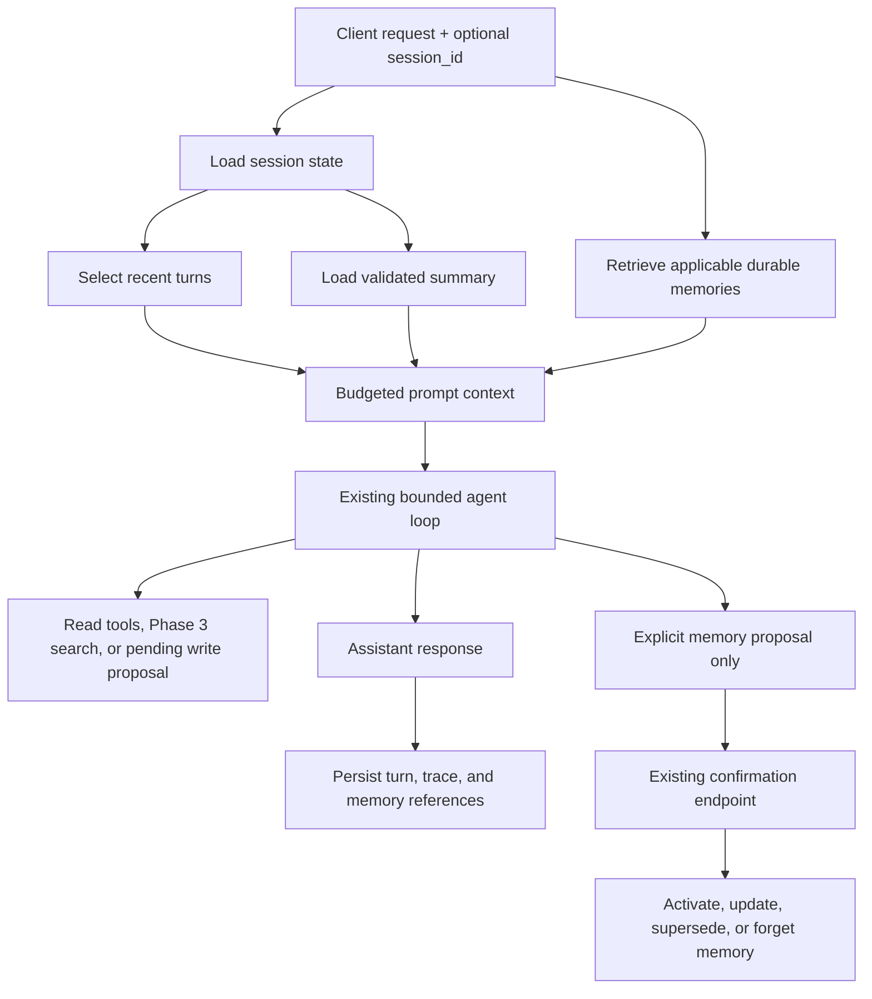

# Home AI Agent System — Version 4: Phase 4 Memory implementation plan

**Updated: 5 October 2026 · Phase 4 complete for the implementation milestone · Phase 5 next**

This document is the execution plan for Phase 4. It follows the completed
local Phase 3 document-retrieval work recorded in
[Phase 3 findings](../../results/phase-3/findings.md) and the
[Version 3 completion record](home-ai-agent-project-plan%20v3.md).

Phase 4 adds memory in two deliberately different forms:

1. **Short-term conversational memory:** save a session's messages and assemble
   enough recent context for the model to continue a conversation. When the
   history becomes too large, summarize older turns while retaining recent
   turns and important operational facts.
2. **Long-term household memory:** store only explicit, user-approved
   preferences or facts that should survive a session, then retrieve them in a
   controlled way in later sessions.

Memory is not a new source of authority. Live device state still comes from
read tools, document facts still come from Phase 3 retrieval, and every write
still becomes a confirmation-gated proposal. A remembered preference can help
interpret a request, but it cannot silently authorize an action or override a
current user instruction.

## 1. Scope and success definition

Phase 4 is a local, single-household experiment. It will use the existing
Python/FastAPI, PostgreSQL, Ollama `qwen3:8b`, tool registry, request tracing,
and bounded five-iteration agent loop. It will not add authentication,
multi-user identity, cloud storage, autonomous memory extraction, or a new
agent framework.

The phase is complete when the system can demonstrate all of the following:

- continue a multi-turn conversation using a stable `session_id`;
- persist user and assistant turns plus relevant tool outcomes without
  exposing internal prompts or secrets;
- enforce a measured context budget and summarize older turns safely;
- save, list, read, update, and forget explicit household preferences;
- distinguish a session summary from durable household memory;
- cite or identify which memory records influenced an answer during debugging;
- prevent a remembered instruction from creating an unconfirmed write;
- keep Phase 2 action regressions and Phase 3 knowledge-mode behavior passing;
- provide a repeatable evaluation showing useful recall, correct forgetting,
  and acceptable behavior when memory is absent, stale, or conflicting.

## 2. What we will learn

| Topic | Practical lesson this project should demonstrate |
|---|---|
| Context windows | A model does not remember a session by itself; the application must choose what to send on every request and must bound growth. |
| Conversation history | Storing every message is different from selecting a useful prompt context. History is durable data; context is a request-time view. |
| Summarization | Compression can save tokens but can drop names, negations, quantities, dates, or safety constraints. A summary needs validation and provenance. |
| Short-term vs long-term memory | A session summary helps continue a conversation; a durable preference is an explicit household record with its own lifecycle. |
| Memory writes | Automatically extracting everything a user says creates surprising and unsafe state. Explicit save/confirm semantics are easier to explain and test. |
| Retrieval and ranking | Similarity or keyword matching can find a memory, but applicability, recency, scope, and conflict rules decide whether it should be used. |
| Forgetting and correction | “Forget this” must remove the memory from future retrieval, not merely tell the model to ignore it. Updates need stable IDs and concurrency checks. |
| Trust boundaries | Retrieved memories are data. They cannot grant tool permissions, bypass confirmation, or override system/application policy. |
| Observability | A final answer is not enough: inspect selected memories, summary versions, token estimates, tool traces, and whether a write was proposed. |
| Production trade-offs | More memory can improve continuity while increasing privacy exposure, prompt cost, stale-fact risk, and debugging complexity. |

## 3. Target behavior

### 3.1 Short-term conversation

A client starts a session and receives an opaque `session_id`. Subsequent
requests include that ID. The API stores the user message, selected context,
assistant response, tool calls, tool results, and request ID. The next prompt is
assembled from:

1. the system prompt and current safety rules;
2. an optional validated summary of older turns;
3. a bounded number of recent turns;
4. explicitly selected memory records;
5. the current user message.

The current message always has priority over an old summary. If the session is
unknown, expired, or omitted, the request behaves as a new session rather than
guessing another household's history. The first implementation should use a
character/token estimate and record it; a later experiment can compare it with
the model's actual usage if the local runtime exposes that information.

### 3.2 Durable preferences

The existing `preferences(key, value, updated_at)` table is a useful Phase 0
foundation, but Phase 4 will add a memory-specific record around it rather than
letting the model write arbitrary JSON. Each durable memory should have:

- a stable ID and a normalized key;
- a typed value or constrained JSON value;
- scope such as `household` or an explicitly named family member;
- status (`active`, `superseded`, or `forgotten`);
- source (`explicit_user`, `confirmed_action`, or `imported`);
- created, updated, and forgotten timestamps;
- optional expiry/review date;
- the request/session that created it;
- a human-readable display statement for confirmation and debugging.

Example: “The family prefers the thermostat at 21°C in winter” can become an
explicit preference only after the user asks to remember it or confirms a
memory proposal. “The thermostat is currently 21°C” must not become a durable
preference; it is live state and must be read from the device tool.

### 3.3 What memory must not do

- It must not be used to answer current device state without a live read.
- It must not replace a document citation for a manual or house rule.
- It must not turn an old request into a new write proposal.
- It must not store hidden prompts, credentials, raw authorization headers, or
  unnecessary sensitive household content.
- It must not silently infer and persist personal attributes from conversation.
- It must not allow remembered text such as “ignore previous instructions” to
  alter permissions or system behavior.

## 4. Proposed architecture



The application, not the model, owns session IDs, selection limits, memory
status, expiry, and confirmation. The model can suggest a memory operation
through a narrow schema, but Python validates it and PostgreSQL persists it.

## 5. Implementation plan

### Step 4.0 — Baseline and data policy

Before changing chat behavior, record the current Phase 2 and Phase 3 test
results and write a short memory data policy. Define what is eligible for
durable storage, what is session-only, retention defaults, redaction rules, and
the exact meaning of “forget.” Use synthetic household examples first.

**Deliverables:** baseline run, data classification table, threat model, and a
small set of end-to-end conversation scripts.

**Learning:** memory is a product and privacy decision as well as a database
feature. The easiest data to store is not necessarily data we should retain.

### Step 4.1 — Add session and message persistence

Add an additive migration, proposed as `005_memory.sql`, with tables similar
to:

| Table | Purpose and important fields |
|---|---|
| `conversation_sessions` | `id`, status, created/last-used/expired timestamps, title or label, schema version. Do not store an assumed user identity. |
| `conversation_messages` | session ID, sequence, role, content, request ID, model, created time, token/character estimate, redaction status. Unique session plus sequence. |
| `conversation_events` | tool call name, normalized arguments, outcome category, latency, request ID, and message/session linkage. Store only the minimum required trace data. |
| `conversation_summaries` | session ID, covered-through sequence, summary text, summary version, source hash, model/configuration, created time, and status. |
| `memory_records` | normalized key, value, scope, status, source, display text, timestamps, expiry/review fields, session/request source, and revision. |
| `memory_events` | create/update/supersede/forget audit event with actor (`user` or `system`), request ID, and old/new record IDs; never copy secret-bearing content into the audit row. |

Use UUIDs for sessions, messages, summaries, and memory records. Keep raw
message content separate from prompt construction. Add indexes for active
sessions, recent message order, active memory scope/key, and event lookup.
Apply retention defaults to old sessions only after the behavior is tested;
do not silently delete durable preferences with conversation cleanup.

**Deliverables:** migration, fresh-schema equivalent, repository helpers, and
database tests for ordering, revision conflicts, duplicate requests, and
session isolation.

### Step 4.2 — Introduce session-aware `/chat`

Extend `ChatRequest` with an optional `session_id` and add a small session API:

- `POST /sessions` — create a session;
- `GET /sessions/{id}` — return safe metadata and counts;
- `GET /sessions/{id}/messages` — return paginated user-visible messages;
- `POST /sessions/{id}/summarize` — request a bounded summary operation;
- `DELETE /sessions/{id}` — propose or execute the documented session deletion
  policy, without deleting durable memory unless explicitly requested.

Keep the existing `/chat` response compatible by adding `session_id`,
`memory_refs`, and context diagnostics only where appropriate. Save a user
message before the model call and finalize the assistant/tool records in a
`finally`-safe path. If model execution fails, record a failure event without
claiming a successful assistant answer.

The first context policy should be deterministic:

- retain the system prompt outside the history budget;
- include a bounded summary when one exists;
- include the newest turns until the configured budget is reached;
- never trim the current user message;
- preserve tool results needed to interpret the latest assistant answer;
- reject or clearly report a request that cannot fit even after trimming.

**Learning:** a database transcript and an effective model context are two
different designs. The selection policy is part of application behavior.

### Step 4.3 — Implement summary compaction

Start with an explicit summary command or threshold-triggered compaction after
the deterministic session path works. Summaries must use a strict schema such
as:

```json
{
  "facts": ["..."],
  "open_questions": ["..."],
  "decisions": ["..."],
  "pending_actions": ["..."],
  "safety_constraints": ["..."],
  "covered_through_sequence": 12
}
```

The summarizer receives only the selected old turns, labels them as untrusted
conversation data, and cannot call household tools or create memory records.
Validate that the covered sequence is correct, the summary is bounded, and
pending actions are not reported as completed. Keep the source messages until
the retention policy says otherwise. On summary failure, use recent turns only
and surface a diagnostic rather than replacing good history with an empty
summary.

Compare three policies on the same scripts: recent-turn truncation, one
summary plus recent turns, and full history until the budget is exceeded.
Measure factual continuity, dropped negations/numbers, prompt size, latency,
and model calls.

### Step 4.4 — Add explicit memory tools and confirmation

Create narrow tools or endpoints, for example:

- `list_memory(scope?, key?)` — active records only, bounded results;
- `get_memory(memory_id)` — exact record and revision;
- `propose_memory_save(key, value, scope, display_text, expires_at?)`;
- `propose_memory_update(memory_id, expected_revision, value, ...)`;
- `propose_memory_forget(memory_id, expected_revision)`.

Memory proposals use the existing pending-action lifecycle and exact stable
payload approach from Phase 3. A proposal describes the normalized value and
human-readable statement. Confirmation performs the database update in a
transaction, supersedes the old revision where applicable, and records an
audit event. The assistant must say “pending confirmation” until that result
exists.

For the first implementation, do not save every preference automatically.
Require a user request such as “remember that…” or an explicit confirmation
after the assistant asks. A later experiment may compare automatic extraction,
but it is outside the completion gate.

**Learning:** the same confirmation boundary used for household writes also
works for memory writes, and prevents the model from becoming the owner of
persistent state.

### Step 4.5 — Retrieve and apply memories safely

Build a deterministic memory selector before considering embeddings. Filter by
`active` status, scope, expiry, and key; order exact key matches by recency and
revision; cap both record count and rendered characters. Include the selected
record IDs and display statements in a delimited, untrusted memory section.

Use explicit conflict rules:

- current user instructions beat remembered preferences;
- a current confirmed preference beats an older superseded record;
- an expired record is not supplied as active context;
- a live tool result beats a remembered state claim;
- conflicting active records produce clarification, not an arbitrary choice;
- a document citation remains required for document-grounded claims.

For debugging, return safe `memory_refs` containing IDs and keys, not hidden
prompt text or sensitive values. Log selection reason and status, but apply
redaction before normal logs. A memory lookup must never enable write tools.

### Step 4.6 — Add forgetting, expiry, and correction

Implement exact-ID forgetting and test that the forgotten record is absent from
future selection. Add optional expiry/review dates and a background-safe
maintenance path that marks expired records rather than deleting audit history.
Test replacement of a preference, concurrent update with an old revision,
repeated forget, unknown IDs, and session deletion separately.

Document the difference between:

- deleting a session transcript;
- forgetting a durable memory;
- deleting a source document from Phase 3; and
- deleting data from backups, which is a separate operational concern.

### Step 4.7 — Evaluate and document the trade-offs

Create a development suite of roughly 20 cases and freeze a separate held-out
set before tuning. Include:

| Group | Example coverage |
|---|---|
| Continuity | pronouns, references to earlier turns, a multi-turn device question, and a follow-up after compaction |
| Context limits | long history, summary threshold, missing summary, and request too large after trimming |
| Memory lifecycle | explicit save/confirm, update, list, expiry, forget, and session deletion |
| Conflicts | current instruction vs old preference, two revisions, stale update, and missing memory |
| Trust/safety | malicious remembered text, memory suggesting a write, live state vs remembered state, and document text attempting to save itself |
| Regression | Phase 2 read/write confirmation cases and Phase 3 citations/injection cases |

Each case records expected session behavior, required memory IDs/statuses,
expected tool family, prohibited writes, answer facts, context budget, and
whether a summary was allowed. Save raw/final responses, selected memory
references, summary versions, tool traces, request IDs, state snapshots, and
cleanup results. Keep development and held-out results separate.

Suggested initial targets are: 100% deterministic session/message ordering and
forgetting tests; 100% no-write checks for memory-only reads and malicious
memory cases; at least 90% continuity on held-out answerable cases; at least
90% correct memory lifecycle outcomes; and no unexplained Phase 2/3 regression.
These targets are local learning gates, not production quality guarantees.

## 6. File and schema implementation map

| Area | Planned files or changes |
|---|---|
| Database | `src/db/migrations/005_memory.sql`, equivalent `src/db/init.sql` additions, migration tests |
| Models/contracts | `src/app/schemas.py` for session, message, memory, summary, and response fields |
| Persistence | New `src/app/memory.py` for sessions, context selection, lifecycle, redaction, and memory policies |
| API | `src/app/main.py` and a new `src/app/memory_routes.py` for sessions and memory operations |
| Agent integration | `src/app/llm.py`, `src/app/prompts.py`, and `src/app/tools.py`; preserve the existing bounded loop |
| Evaluation | New `src/app/evaluate_phase4.py`, `results/phase-4/` cases, manifests, traces, and findings |
| Tests | Unit tests for budgets/policies plus isolated PostgreSQL/API tests for lifecycle and concurrency |
| Documentation | README session examples, privacy/data policy, and this completion record after verification |

These are implementation targets, not claims that the files already exist.
Keep memory records and internal session tables out of generic household CRUD
unless a narrowly designed route is explicitly added.

## 7. Build order and completion gates

| Order | Deliverable | Gate before advancing |
|---|---|---|
| A | Data policy, baseline, migration, repositories | Existing Phase 2/3 regressions pass; schema is additive; session isolation tests pass |
| B | Session-aware chat and persistence | Multi-turn continuation works; failed calls are recorded accurately; no secrets enter stored content |
| C | Deterministic context budget | Prompt size is bounded; recent-turn and too-large behavior is tested |
| D | Summary compaction experiment | Covered sequence, pending status, and failure fallback are validated |
| E | Explicit memory lifecycle | Save/update/forget use stable IDs and confirmation; stale/concurrent operations are safe |
| F | Memory selection and conflict policy | Current/live/document evidence rules hold; malicious memory cannot authorize tools |
| G | Held-out evaluation and documentation | Targets are assessed honestly; limitations, retention, and trade-offs are written down |

Start with A–C before adding model-generated summaries. Implement memory
mutation and forgetting before allowing memory to influence normal assistant
answers. This gives every later result a deterministic baseline for comparison.

## 8. Expected limitations and deferred work

Phase 4 will not solve identity, multi-user permissions, semantic memory
entailment, perfect summarization, cross-device synchronization, encrypted
storage, cloud backups, automatic personal-profile construction, or lifelong
unbounded memory. It will not claim that a remembered statement is true merely
because it is stored.

Possible Phase 5+ experiments include vector search over a larger memory set,
reranking, user/family-member namespaces after authentication, encrypted or
redacted storage, event-sourced conversation replay, and a framework-backed
memory implementation for comparison. Each requires a measured need and a
clear privacy model first.

## 9. Phase 4 completion record

Phase 4 is complete as an implementation milestone on 5 October 2026. The
repository now contains the additive `005_memory.sql` schema, session-aware
chat integration, persisted conversation messages, bounded context selection,
summary persistence, explicit confirmation-gated memory save/update/forget
operations, expiry/status filtering, revision checks, and Phase 4 unit tests.

The Phase 4 unit checks passed. Full PostgreSQL-backed verification remains a
follow-up because PostgreSQL was unavailable in the verification environment;
the Phase 2/3 database suites were therefore skipped. Two existing Phase 3
temporary-file tests were also blocked by the Windows sandbox rather than by
an application assertion. These are recorded limitations, not reasons to
delay the next learning milestone, but they must be rerun before a production
readiness claim.

The remaining Phase 4 hardening items are carried forward as regression work:
add the missing database/evaluation evidence, verify summary compaction and
forgetting end to end, and confirm that memory selection cannot authorize a
write or replace live/document evidence.

## 10. How to proceed with Phase 5 — single-agent ReAct loop

Phase 5 should extend the existing bounded loop rather than replace the Phase
4 session and memory boundaries. Build and measure the hand-written loop first,
then reproduce the same behavior in LangGraph.

### Step 5.0 — Freeze the Phase 4 baseline

Run the Phase 2/3 regression suites with PostgreSQL available, add an end-to-
end session script, and save a small baseline under `results/phase-5/`. Use
the same model and tool policies as Phase 4 so changes in quality or latency
can be attributed to the loop.

### Step 5.1 — Generalize the existing loop

Refactor the current one-turn tool path in `src/app/llm.py` into a loop that:

1. builds the prompt from the Phase 4 session context;
2. asks the model for either a final answer or a tool call;
3. validates the tool name and arguments against the registry;
4. executes one tool and appends the normalized result;
5. repeats until a final answer, failure, or the iteration limit.

Keep the existing confirmation gate: a write produces a pending action and
does not execute merely because a later loop iteration requests it. Preserve
request IDs, session messages, tool traces, memory references, and truthful
pending/failed/completed status in the response.

### Step 5.2 — Add loop protection and deterministic failure behavior

Use a small configurable maximum such as 5 iterations. Stop on repeated
identical tool calls, malformed arguments, unknown tools, tool exceptions,
context overflow, or a model that never returns a final answer. Return a
diagnostic that says what happened without claiming that an unconfirmed or
failed action completed.

### Step 5.3 — Evaluate multi-step requests

Start with read-only chains, then mixed read/write requests, for example:
check inventory then prepare a shopping-list proposal; read a device state then
answer; and combine a document lookup with a live device read. Add adversarial
cases for tool-result prompt injection, remembered text suggesting a write,
duplicate calls, and loops. Measure tool-call order, iteration count, latency,
pending actions, final answer correctness, and no-write safety.

### Step 5.4 — Rebuild the same behavior in LangGraph

Only after the hand-written loop is stable, model the same states and edges in
LangGraph: `load_context`, `model`, `validate_call`, `execute_tool`, and
`finalize`. Compare code size, traceability, retries, persistence, and failure
behavior. Keep the hand-written version as the reference implementation so
the framework is evaluated rather than trusted by default.

### Step 5.5 — Phase 5 completion gate

Complete Phase 5 when both implementations pass the same frozen cases, the
iteration cap and duplicate-call protection are demonstrated, confirmation
gating remains intact, Phase 4 session/memory behavior still works, and the
results document explains when LangGraph helps and when the simpler loop is
preferable.

## 11. Phase 4 historical checklist

- [ ] Approve and implement the memory data policy — carried forward.
- [x] Add `005_memory.sql` and fresh-database equivalents.
- [x] Add session/message persistence and request-linked traces.
- [x] Add bounded session context with deterministic selection.
- [ ] Add validated summary records and compaction fallback — carried forward.
- [x] Add explicit, confirmation-gated memory save/update/forget operations.
- [x] Add active/expired status and household-scope rules.
- [ ] Add superseded conflict handling, safe memory references, and redacted observability — carried forward.
- [ ] Add development and frozen held-out Phase 4 evaluations — carried forward.
- [ ] Re-run Phase 2 and Phase 3 regression suites with PostgreSQL available — carried forward.
- [x] Record the implementation completion and limitations in this document.

Phase 4 begins after Phase 3's local-scope completion on 5 October 2026.
