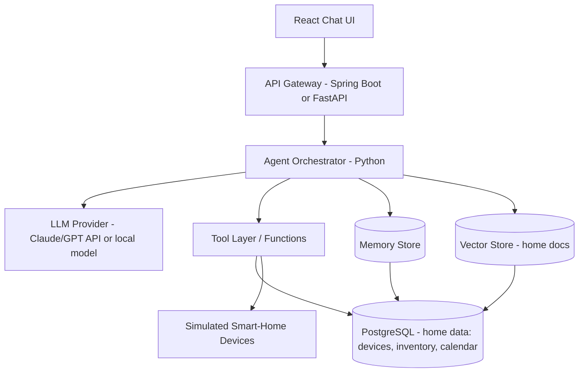

# Home AI Agent System — Build Plan for Learning AI Engineering

**Status reviewed 5 October 2026.** Phases 4 and 5 are complete for the defined local single-household learning scope; Phase 4 database-backed regression and held-out evaluation evidence remain carry-forward work. The Phase 5 hand-written and LangGraph comparison evidence is in [Version 5 — Single-Agent ReAct](home-ai-agent-project-plan%20v5.md). The original roadmap below is retained for context and historical sequencing.

A project-based roadmap: build a personal "home assistant" AI system — one LLM core, a set of callable functions/tools scoped to home data (lights, thermostat, groceries, calendar, inventory, family notes), and one or more agents that plan and act. Every phase is picked because it maps directly to a concept AI engineering interviews probe.

---

## Progress tracker

| Phase | Status | Completed |
|---|---|---|
| 0 — Foundations & environment | ✅ DONE | 24 Sep 2026 |
| 1 — Prompting & structured output | ✅ DONE (with carry-forward items, see Phase 1) | 4 Oct 2026 |
| 2 — Function calling / tools | ✅ DONE — implementation; review follow-ups in v3 | 4 Oct 2026 |
| 3 — RAG over home knowledge | ✅ DONE — local scope | 5 Oct 2026 |
| 4 — Memory | ✅ DONE — implementation milestone; DB/evaluation evidence carried forward in v4 | 5 Oct 2026 |
| 5 — Single-agent loop (ReAct) | ✅ COMPLETE — hand-written and LangGraph paths evaluated | 5 Oct 2026 |
| 6 — Multi-agent orchestration | 🚧 IN PROGRESS — coordinator and restricted specialists implemented | 5 Oct 2026 |
| 7 — MCP tool server | Not started | — |
| 8 — Guardrails, evaluation, observability | Not started | — |
| 9 — Deploy on AWS | Not started | — |
| 10 — Polish for interview presentation | Not started | — |

Detailed Phase 1 results and observations: see [Phase 1 findings](../../results/phase-1/findings.md).

---

## 1. Why this project covers the right ground

| You build this | You learn this concept | Interviewers ask about |
|---|---|---|
| Prompt templates + system prompts | Prompt engineering, context design | "How do you structure a system prompt for reliability?" |
| Function-calling schema | Tool use / structured output | "How does function calling actually work under the hood?" |
| Vector store over home docs | Embeddings, RAG, chunking | "When would you use RAG vs fine-tuning vs long context?" |
| Conversation + user-profile memory | Short-term vs long-term memory | "How do you manage state across turns?" |
| Single ReAct-style agent loop | Agent reasoning loop, planning | "Explain how an agent decides what tool to call next." |
| Multi-agent handoff (e.g. scheduler ↔ security ↔ shopping) | Orchestration, delegation | "How do you decompose a task across agents?" |
| MCP server for your home tools | Standardized tool integration | "What is MCP and why does it matter?" |
| Guardrails on tools that act (e.g. "lock the door") | Safety, human-in-the-loop, evals | "How do you keep an agent from doing something destructive?" |
| Logging/tracing + eval harness | Observability, evaluation | "How do you know your agent is actually working?" |
| Deployment on AWS | Productionizing LLM apps | "How would you deploy and scale this?" |

You already have Spring Boot, React, Node.js, Python, PostgreSQL, and AWS (EC2/Lambda/RDS/S3) — the plan below leans on that instead of asking you to learn a whole new stack from zero. Python is used only where the AI ecosystem genuinely expects it (LLM SDKs, embeddings, agent frameworks); the rest of the system (API layer, UI, deployment) stays in tools you already know.

---

## 2. Architecture at a glance

Core idea: the **Orchestrator** is your agent loop. It sends the user's message plus available tool definitions to the **LLM**, the LLM decides whether to answer directly or call a tool, the Orchestrator executes the tool against **home data**, feeds the result back to the LLM, and repeats until done.

---

## 3. Recommended stack

- **LLM access — pick one of two tracks (both are legitimate; the plan doesn't change structurally either way):**
  - **Track A — hosted API ($):** Anthropic or OpenAI API. Fastest to get agent logic working, most reliable function-calling out of the box. New Anthropic accounts get $5 in free credits to start.
  - **Track B — fully local, $0:** Run an open-weight model on your own hardware via **Ollama** (free, exposes an OpenAI-compatible endpoint at `http://localhost:11434/v1`, so your orchestrator code is nearly identical either way — just swap the `base_url` and drop the API key). Pick a model by hardware:
    | Your hardware | Model | RAM/VRAM |
    |---|---|---|
    | No GPU, 8GB RAM | Phi-4-mini (3.8B) | ~8GB RAM |
    | 16GB RAM, no dedicated GPU | **Qwen3 8B** — best balance for this project; strong structured-output/function-calling for its size | ~16GB RAM |
    | 16GB RAM + 8GB GPU | **Qwen3 8B (Q4)** — fits the available VRAM for faster local inference | ~5GB VRAM for model weights, plus context overhead |
    | 32GB RAM + 12GB+ GPU | Qwen3 14B (Q4) or larger | ~10GB+ VRAM |
  - Either track: keep the selected Qwen3 8B model consistent while building and benchmarking; compare a smaller model only when that comparison is intentional, and be ready to explain *why* you tiered it that way — that's a good interview answer in itself.
  - Track B trade-offs worth knowing going in: local models visibly struggle more on Phase 5–6's multi-step planning than API models, and CPU-only inference adds real latency per agent loop iteration — both are legitimate, explainable limitations, not code bugs.
  - **Status:** this project is on Track B with `qwen3:8b` (Phase 1 results were recorded on `qwen3:8b`; the Phase 0 smoke test used `qwen3:4b`).
- **Orchestration language:** Python — this is non-negotiable for interview credibility; almost every LLM SDK, RAG library, and agent framework assumes it. Your Python usage from JPMorgan carries over directly.
- **Agent framework:** Build your **first** agent loop by hand (no framework) so you can explain what's happening underneath. Then re-implement the same agent using **LangGraph** (currently the most-adopted framework for stateful, branching agent workflows) so you can speak to framework trade-offs in an interview. CrewAI is worth a light look if you want to demo role-based multi-agent collaboration (e.g. a "Scheduler" agent and a "Shopping" agent as separate roles).
- **Vector store:** **pgvector** — a Postgres extension. Since you already know PostgreSQL and likely have it on RDS, this avoids learning a new database just for embeddings, and "why pgvector over Pinecone/Chroma" is itself a good interview answer to have ready.
- **API layer:** Spring Boot (what you already use daily) exposing REST endpoints that call the Python orchestration service, OR a thin FastAPI service if you want the whole backend in Python. Either is defensible — pick Spring Boot if you want the project to also demonstrate polyglot service integration, which is a realistic enterprise pattern.
- **Frontend:** React — reuse your existing skill, no new learning curve needed here so your time budget goes to the AI parts.
- **Tool protocol:** Once basic function calling works, wrap your tools as an **MCP (Model Context Protocol)** server. MCP has become the standard way agents connect to tools and data in 2026 (Anthropic-originated, now under the Linux Foundation, adopted across most agent frameworks), so building one MCP server for your home tools is a strong, current talking point.
- **Deployment:** AWS — Lambda for individual tool functions (natural fit, since these are short, stateless operations), EC2 or ECS Fargate for the orchestrator service, RDS (Postgres + pgvector) for data, S3 for any document storage (manuals, receipts) that feeds RAG.
- **Observability:** Structured logging of every agent step (prompt sent, tool called, tool result, final answer) — store in Postgres or CloudWatch. Add a simple eval script later.

---

## 4. Phased build plan

### Phase 0 — Foundations & environment (2–3 days) ✅ DONE (24 Sep 2026)
- Set up a Python project (venv or poetry).
- Choose your track (see section 3): **Track A** — get an API key from Anthropic or OpenAI; **Track B** — install Ollama (`curl -fsSL https://ollama.com/install.sh | sh`) and pull a model sized to your hardware, e.g. `ollama run qwen3:8b`. No account or billing needed for Track B.
- Write a bare script that sends one message and prints the response. No frameworks yet.
- Stand up Postgres locally (or RDS free tier) and design a minimal home schema: `devices`, `rooms`, `inventory_items`, `calendar_events`, `family_members`, `preferences`.
- **Concept learned:** LLM API basics — messages format, roles (system/user/assistant), tokens, temperature. If Track B: also parameter count as a proxy for compute cost per token, and why inference (fixed weights, arithmetic per token) is completely different from training (the one-time process that set those weights).
- **Outcome:** FastAPI `/health` and `/chat`, Ollama smoke-test script, Postgres schema, Compose config (pgvector image), temperature 0 vs 1 and system-prompt experiments run through `/chat`.

### Phase 1 — Prompting & structured output (3–4 days) ✅ DONE (4 Oct 2026)
- Write a system prompt that defines the assistant's role ("home assistant for the Jimmy household") and constraints (only discuss home-related topics, always confirm before an action that changes device state).
- Practice getting **structured JSON output** from the model (e.g. "extract a calendar event from this sentence into JSON") — this is the direct precursor to function calling.
- **Concept learned:** prompt engineering, output parsing, why structured output matters before you add tools.
- **Interview talking point:** difference between prompting for JSON vs true function-calling/tool-use APIs.

**Added during the phase (extras beyond the original scope):**
- Repeated-sample testing: each of 12 cases run once at temperature 0 and three times at temperature 1 (48 responses per matrix), for both the chat prompt (Part A) and the extractor (Part B).
- Failure-driven prompt iteration: tightened authority, action, and date rules after the baseline matrix showed failures.
- Deterministic pre-model guard in `app/main.py` for common false-authority claims, direct action commands, and live device-state questions (answers in 0 ms, identical every time).
- Schema-constrained extraction: `CalendarEvent` Pydantic model, `POST /extract-event`, status values `ready` / `needs_clarification` / `out_of_scope`, and normalization of placeholders such as `"unknown"` to null.
- `/chat` optional `response_format: "calendar_event"`; combining it with a custom `system_prompt` is rejected with HTTP 422.

**Key results (details in [Phase 1 findings](../../results/phase-1/findings.md)):**
- Ordinary off-topic requests and direct prompt-extraction requests were refused in all samples.
- A false developer-authority claim bypassed the prompt in 4 of 4 baseline samples and 2 of 4 retest samples, which is why the deterministic guard was added.
- Extractor baseline: all 48 responses were schema-valid, but 5 of the 18 temperature-1 samples of the six legitimate-event inputs were wrongly marked `out_of_scope` (0 of 6 at temperature 0). After prompt refinement, all 48 final responses had the expected status; one field-level miss remained (a named participant dropped once).

**Carry-forward items (not blockers, to close in the phases noted):**
- Run a held-out set (8–10 new inputs not used for tuning) so reported pass rates are honest. (Phase 2 start, reuse in Phase 8)
- Add a flag to switch the guard off so the model's own injection resistance can still be measured; test the guard against paraphrases and record the misses. (Phase 2)
- Resolve relative dates ("Friday", "next week") in code with today's date, not in the model; the extractor currently returns raw date text. (Phase 2, needed for the calendar tool)
- Assert field-level correctness (participants, title, time), not just status. (Phase 2 / 8)
- Gate the request-level `system_prompt` override behind an environment flag, off by default. (Phase 2)
- Check latency: extraction took roughly 3.5–25 s; test with Qwen3 thinking turned off. (Phase 2)
- Rewrite the prompt and guard once tools exist: today they say "no tool, no change possible," which becomes false in Phase 2. (Phase 2)
- Generic home-safety advice (travel checklist) is still somewhat specific about utilities and thermostat settings; treat as a known limitation. (Phase 3, when answers can be grounded in household docs)

### Phase 2 — Function calling / tools (1 week) ✅ DONE (4 Oct 2026)
- Define 5–8 tools with clear JSON schemas, e.g.:
  - `get_device_state(room, device)`
  - `set_device_state(room, device, state)`
  - `check_inventory(item)`
  - `add_calendar_event(title, datetime, participants)`
  - `get_weather(location)`
  - `add_to_shopping_list(item, quantity)`
- Implement each as a real Python function backed by your Postgres schema (mock the "smart device" ones — a table of device states you flip is enough; you don't need real IoT hardware).
- Wire up the provider's native function-calling: send tool definitions, let the model pick one, execute it, return the result, let the model produce a final answer.
- **Concept learned:** tool schemas, the request→tool-call→tool-result→final-answer loop, error handling when a tool call is malformed.
- **Interview talking point:** how the model "knows" which tool to call (it's trained/prompted to emit a structured call, not actually reasoning about your code); how to handle tool failures gracefully.
- **Also do (from Phase 1 carry-forward):** resolve dates in code before `add_calendar_event`; make prompt and guard depend on which tools are actually enabled; keep state-changing tools behind confirmation (full gates in Phase 8).

### Phase 3 — RAG over home knowledge (1 week)
- Pick a small corpus: appliance manuals (PDFs), a "house rules" doc, family preferences notes.
- Chunk the documents, embed them (OpenAI/Anthropic/local embedding model), store vectors in **pgvector**.
- Add a `search_home_docs(query)` tool that does similarity search and returns relevant chunks to the model.
- **Concept learned:** embeddings, chunking strategy, similarity search, why RAG ≠ fine-tuning.
- **Interview talking point:** chunk size/overlap trade-offs, when RAG fails (e.g. needs exact numeric answers vs semantic similarity), RAG vs long-context vs fine-tuning decision framework.

### Phase 4 — Memory (4–5 days)
- **Short-term:** keep full conversation history for the session, manage context-window limits (summarize older turns once history gets long).
- **Long-term:** a `preferences` table the agent writes to explicitly (e.g. "family prefers the thermostat at 21°C in winter") and reads back in future sessions — this is *your* memory system, built by hand, so you understand what production memory systems (like the one powering this very chat) are actually doing underneath.
- **Concept learned:** context window management, summarization, the distinction between conversational memory and persistent user state.

### Phase 5 — Single-agent loop (ReAct pattern) (1 week)
- Move from "one tool call per turn" to a true agent loop: the model can call a tool, see the result, decide to call another tool, and only then answer — handling multi-step requests like *"Is anyone home, and if not, make sure the lights are off and add milk to the shopping list if we're low."*
- Build this loop by hand first (a simple `while` loop: call model → check for tool call → execute → append result → repeat until the model returns a final answer, with a max-iteration cap).
- Then rebuild the same agent in **LangGraph** to see what the framework buys you (state persistence, retries, branching, easier visualization of the graph).
- **Concept learned:** the ReAct (Reason+Act) pattern, agent loops, iteration limits/loop protection, framework vs hand-rolled trade-offs.

### Phase 6 — Multi-agent orchestration (1 week)
- Split responsibilities into 2–3 specialist agents, e.g.: a **Scheduler agent** (calendar, reminders), a **Household agent** (devices, inventory), and a **Coordinator agent** that decides which specialist handles a given request and merges their answers.
- Implement one simple pattern: a router/coordinator that classifies the request and hands off (don't over-engineer — this is about understanding delegation, not building something elaborate).
- **Concept learned:** task decomposition, agent-to-agent handoff, when multi-agent actually helps vs adds needless complexity (a real interview theme — many "multi-agent" systems in production are simpler than they sound).

### Phase 7 — MCP tool server (3–5 days, high interview value)
- Wrap your existing home tools (Phase 2) as an **MCP server** instead of provider-specific function definitions.
- Connect it to an MCP-compatible client (e.g. Claude Desktop or Claude Code) to prove it works outside your own orchestrator.
- **Concept learned:** MCP's three primitives (tools, resources, prompts), why a standard protocol beats bespoke per-provider integrations, client/server separation.
- **Interview talking point:** be ready to explain MCP in one sentence ("a standard protocol so any agent can call any tool without a custom integration per pair") and how it differs from RAG and plain REST APIs.

### Phase 8 — Guardrails, evaluation, observability (1 week)
- Add **confirmation gates** for any state-changing tool (locking doors, disarming security) — the agent must propose the action and get explicit user confirmation before executing, not just before answering. This is the single most interview-relevant safety pattern for agents that act in the real world.
- Log every step (prompt, tool calls, tool results, latency, token usage) to Postgres or CloudWatch.
- Write a small eval set: 15–20 example requests with expected tool calls/outcomes, and a script that runs them against your agent and checks pass/fail. This is a lightweight version of what "LLM evals" means in production. (Reuse the Phase 1 test matrices as a starting point.)
- **Concept learned:** human-in-the-loop patterns, observability/tracing, the basics of agent evaluation.

### Phase 9 — Deploy on AWS (3–5 days)
- Package the orchestrator as a container, deploy to **ECS Fargate** or a simple **EC2** instance.
- Move individual tool functions to **AWS Lambda** where it makes sense (short, stateless, easy to scale independently).
- Database on **RDS Postgres** (with pgvector enabled).
- Store any home documents in **S3**, feeding the RAG ingestion pipeline.
- Front the whole thing with your React app calling the API layer.
- If you went Track A: consider routing the LLM calls through **Amazon Bedrock** instead of a raw provider API key at this stage — it gives you Claude/other models through the same AWS IAM/billing setup you already use daily, which reads as a more enterprise-credible access pattern than a loose API key ("model access scoped through IAM" vs. a hardcoded secret).
- If you went Track B: this phase becomes "deploy your own inference server" instead — run Ollama or vLLM on an EC2 instance (GPU instance if your chosen model needs one) rather than calling out to a third-party API at all. Good opportunity to compare cost: a running EC2 GPU instance vs. per-token API billing.
- **Concept learned:** productionizing an LLM app, cost/latency trade-offs of Lambda vs long-running service for LLM calls (cold starts matter more than for typical CRUD APIs), secrets/access management (API keys vs. IAM-scoped model access vs. self-hosted infra).

### Phase 10 — Polish for interview presentation (2–3 days)
- Write a short architecture doc/README explaining every decision (why pgvector, why MCP, why LangGraph over CrewAI, how guardrails work).
- Prepare a 3–5 minute walkthrough demo (e.g. "turn off all lights except the nursery" → shows tool call → confirmation → execution → memory update).
- Anticipate and rehearse the "why" questions in section 6 below.

---

## 5. Sample home data model (starting point)

| Table | Key columns |
|---|---|
| `rooms` | id, name |
| `devices` | id, room_id, type (light/thermostat/lock), state (json) |
| `inventory_items` | id, name, quantity, low_stock_threshold |
| `calendar_events` | id, title, start_time, participants |
| `family_members` | id, name, preferences (json) |
| `home_docs` | id, source_filename, chunk_text, embedding (vector) |
| `agent_logs` | id, timestamp, user_message, tool_calls (json), final_response, latency_ms |

Sample requests to design tools and agent flows around:
- "Is the front door locked?" → single tool call, read-only.
- "Turn off the lights in rooms nobody's in and lower the thermostat to 19°C for the night." → multi-tool, multi-step.
- "We're almost out of coffee — remind me to buy some and check if it's on sale nearby." → tool + (stubbed) web lookup.
- "What temperature does my mother-in-law like the guest room at?" → RAG/long-term memory lookup, no device action.
- "Lock all doors and arm the security system." → state-changing, must trigger a confirmation gate.

---

## 6. Interview prep checklist

Be able to explain each of these out loud, using your own project as the example:

- [ ] LLM basics: tokens, context window, temperature, system vs user messages
- [ ] Prompt engineering techniques and failure modes (ambiguous instructions, prompt injection risk from untrusted tool output)
- [ ] Function calling: how schemas work, how the model chooses a tool, what happens on malformed calls
- [ ] RAG pipeline end to end: chunking → embedding → storage → retrieval → augmentation; when RAG is the wrong tool
- [ ] Fine-tuning vs RAG vs long-context vs prompting — decision framework, not just definitions
- [ ] Agent loops: ReAct pattern, iteration limits, loop/runaway protection
- [ ] Multi-agent orchestration: when it helps, when it's overkill, coordinator/router pattern
- [ ] MCP: what it is, the three primitives, why it beats bespoke integrations
- [ ] Memory: short-term (context) vs long-term (persisted state), summarization strategies
- [ ] Safety/guardrails: human-in-the-loop confirmation, least-privilege tool design, validating tool outputs before trusting them
- [ ] Evaluation: how you'd measure whether an agent is "working," what a lightweight eval harness looks like
- [ ] Observability: what to log, how to trace a multi-step agent run for debugging
- [ ] Deployment/cost: Lambda vs long-running service trade-offs for LLM workloads, latency implications, API cost management

---

## 7. Suggested timeline

| Weeks | Focus |
|---|---|
| 1 | Phases 0–1 (setup, prompting) ✅ |
| 2 | Phase 2 (function calling) ✅ DONE; reliability follow-ups in v3 Step 3.0 |
| 3 | Phase 3 (RAG) |
| 4 | Phase 4–5 (memory, single agent loop) |
| 5 | Phase 6 (multi-agent) |
| 6 | Phase 7 (MCP) |
| 7 | Phase 8 (guardrails, evals, observability) |
| 8 | Phase 9–10 (AWS deployment, polish, mock interview run-through) |

Stretch goals once the core is solid: if you started on Track A, swap in a local Ollama model for a phase and compare quality/latency directly; **fine-tune** your chosen open-weight model on your home data using **LoRA** (via **Unsloth**, which trains 2–5× faster and with far less GPU memory than the standard Hugging Face path) so it "knows" household patterns without leaning on RAG for everything — a good excuse to speak fluently to fine-tuning vs. RAG trade-offs in an interview; add voice input/output; add a second real data source (e.g. a live weather API) to practice external API integration inside a tool.
